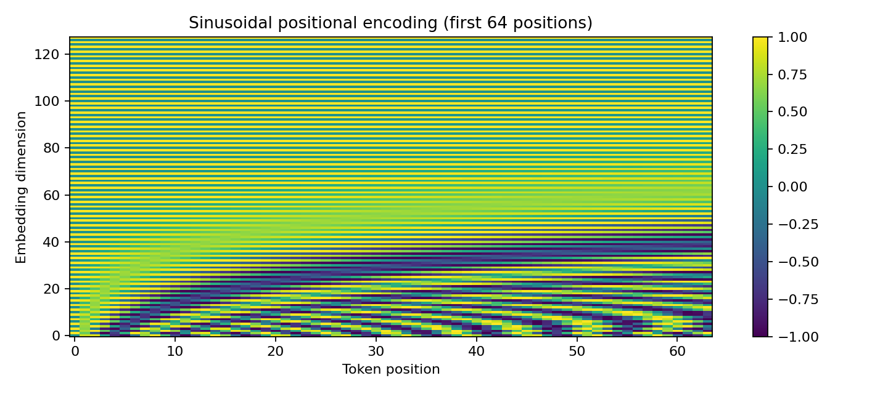
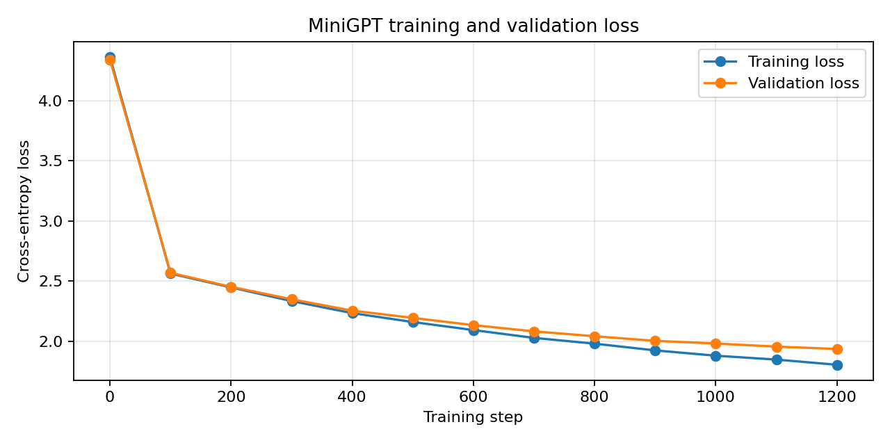
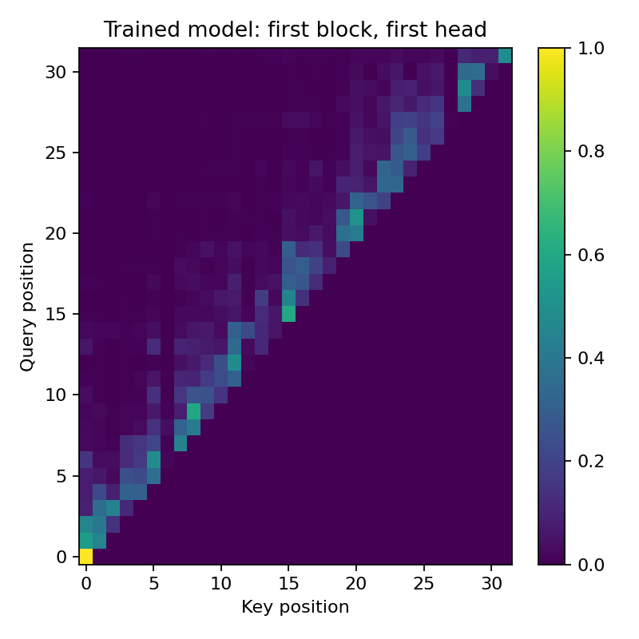

# MiniGPT From Scratch

MiniGPT From Scratch is a compact GPT-style causal language model implemented directly in PyTorch and trained on the Tiny Shakespeare corpus. The purpose of the project is to build the full language-modeling pipeline from first principles instead of loading a pretrained GPT model or using a high-level pretrained Transformer architecture.

The project covers the complete path from raw text to generated text:

```text
Raw text
   |
   v
Character tokenizer
   |
   v
Token IDs
   |
   v
Fixed-length input/target sequences
   |
   v
Token embeddings
   |
   v
Sinusoidal positional encoding
   |
   v
Causal Transformer blocks
   |
   v
Contextual token representations
   |
   v
Vocabulary logits
   |
   v
Next-token probabilities
   |
   v
Autoregressive text generation
```

The model implements its own tokenization pipeline, scaled dot-product self-attention, causal masking, multi-head attention, sinusoidal positional encoding, Transformer blocks, next-token training objective, autoregressive generation, checkpointing, model tests, attention inspection, and controlled ablation experiments.

No pretrained GPT, GPT-2, BERT, Llama, Mistral, or other pretrained language-model checkpoint is used in the core model.

---

## Project Goal

The central goal is to understand and implement how a GPT-style causal language model works internally.

Instead of treating a Transformer as a black box, the project explicitly builds and tests the major components:

- deterministic character-level tokenization
- next-token input/target construction
- token embeddings
- sinusoidal positional encoding
- query, key, and value projections
- scaled dot-product attention
- causal future-token masking
- multi-head attention
- residual connections
- layer normalization
- feed-forward networks
- stacked Transformer decoder blocks
- language-model output projection
- token-level cross-entropy loss
- autoregressive generation
- temperature sampling
- top-k sampling
- checkpoint saving and reloading
- causal correctness tests
- controlled architecture experiments

The final trained model accepts a text prompt such as `ROMEO:` and repeatedly predicts the next character to extend the prompt.

---

## Dataset

The model is trained on Tiny Shakespeare.

The executed training notebook used:

| Item | Value |
|---|---:|
| Total characters | 1,115,394 |
| Vocabulary size | 65 characters |
| Training tokens | 1,003,854 |
| Validation tokens | 111,540 |
| Train/validation split | 90% / 10% |

The vocabulary is created by collecting every unique character in the corpus and sorting the characters deterministically.

Examples of vocabulary elements include letters, punctuation, spaces, and newline characters.

---

# Architecture

## 1. Character-Level Tokenizer

The tokenizer maps every unique character to an integer ID.

For example, conceptually:

```text
'A' -> 0
'B' -> 1
'C' -> 2
...
```

Two dictionaries are created:

```text
stoi: character -> integer ID
itos: integer ID -> character
```

Encoding converts text into token IDs:

```python
encode("ROMEO:")
```

Decoding converts token IDs back into text:

```python
decode(token_ids)
```

Because this project uses character-level modeling, the vocabulary contains only 65 tokens for the Tiny Shakespeare corpus.

The tokenizer is deterministic, so the same character always maps to the same token ID.

---

## 2. Next-Token Training Sequences

The language model is trained to predict the next character.

For a sequence such as:

```text
ROMEO
```

the input and target are shifted by one position:

```text
Input:   R O M E
Target:  O M E O
```

The notebook creates batches of contiguous sequences with a context length of 128 characters.

The main training batch shape is:

```text
Input:  (64, 128)
Target: (64, 128)
```

This means each training batch contains 64 independent sequences, each containing 128 tokens.

---

## 3. Token Embedding Layer

Integer token IDs cannot directly represent relationships between characters, so each token is mapped to a learned vector.

The model uses:

```python
nn.Embedding(vocab_size, d_model)
```

For the final model:

```text
vocab_size = 65
d_model = 128
```

Therefore each character becomes a learned 128-dimensional vector.

For a batch of 64 sequences with 128 tokens each, the embedding output has shape:

```text
(64, 128, 128)
```

or:

```text
(batch, sequence_length, embedding_dimension)
```

---

## 4. Sinusoidal Positional Encoding

Self-attention by itself does not know the order of tokens. The model therefore adds positional information to every token embedding.

This project implements sinusoidal positional encoding directly.

For position `pos` and embedding dimension `i`, the encoding uses sine and cosine waves at different frequencies:

```text
PE(pos, 2i)   = sin(pos / 10000^(2i/d_model))
PE(pos, 2i+1) = cos(pos / 10000^(2i/d_model))
```

The positional vectors are added to the learned token embeddings:

```text
representation = token_embedding + positional_encoding
```

This allows the model to distinguish sequences that contain the same characters in different orders.

The positional encoding is stored as a non-trainable PyTorch buffer and supports the full configured context length.



---

## 5. Self-Attention

Self-attention allows each token to decide which earlier tokens are useful when building its representation.

Each attention head creates three learned projections from the input representation:

```text
Q = Query
K = Key
V = Value
```

The project implements separate linear projections:

```python
self.query = nn.Linear(d_model, head_dim, bias=False)
self.key   = nn.Linear(d_model, head_dim, bias=False)
self.value = nn.Linear(d_model, head_dim, bias=False)
```

### Attention scores

Query vectors are compared with key vectors using a dot product:

```text
Q K^T
```

The scores are divided by the square root of the key dimension:

```text
scores = (Q K^T) / sqrt(d_k)
```

Scaling keeps the magnitude of the dot products controlled as the vector dimension grows.

### Softmax

After masking, softmax converts the scores into normalized attention weights:

```text
weights = softmax(scores)
```

Every row of the attention matrix represents how strongly one query position attends to available key positions.

### Weighted values

The attention output is produced by combining the value vectors according to the attention weights:

```text
output = weights V
```

The full attention operation can be summarized as:

```text
Attention(Q, K, V) = softmax((Q K^T) / sqrt(d_k) + mask) V
```

---

## 6. Causal Masking

MiniGPT is an autoregressive language model. A token is allowed to use its own position and earlier positions, but it must never use information from future positions.

The project creates a lower-triangular causal mask:

```text
1 0 0 0
1 1 0 0
1 1 1 0
1 1 1 1
```

A value of `1` means the position is visible. A value of `0` means the position is blocked.

Before softmax, blocked attention scores are replaced with negative infinity:

```python
scores = scores.masked_fill(mask == 0, float("-inf"))
```

After softmax, every forbidden future position receives an attention probability of zero.

This property is what makes the model causal and prevents information leakage during next-token prediction.

The project verifies causal behavior in two ways:

1. it checks that every attention value above the diagonal is zero;
2. it changes future tokens and confirms that logits for earlier positions remain exactly unchanged.

In the executed end-to-end causal invariance test, the maximum difference in earlier logits after modifying only future tokens was:

```text
0.0
```

---

## 7. Multi-Head Attention

Instead of using one attention operation over the entire representation, the model uses multiple attention heads.

The final model uses:

```text
n_heads = 4
d_model = 128
```

The dimension handled by each head is therefore:

```text
head_dim = d_model / n_heads
         = 128 / 4
         = 32
```

Each head independently computes:

```text
Q -> K -> V -> causal attention -> head output
```

The outputs of all heads are concatenated:

```text
Head 1
Head 2   -> concatenate -> linear projection -> multi-head output
Head 3
Head 4
```

For an input representation with shape:

```text
(B, T, 128)
```

each head produces:

```text
(B, T, 32)
```

After concatenating four heads:

```text
(B, T, 128)
```

A final learned linear projection mixes information from the heads while preserving the model dimension.

---

## 8. Transformer Block

The project uses decoder-style Transformer blocks designed for causal language modeling.

Each block contains two main sublayers:

1. causal multi-head self-attention
2. position-wise feed-forward network

The block uses pre-layer normalization and residual connections.

The implementation follows this flow:

```text
Input x
   |
   v
LayerNorm
   |
   v
Causal Multi-Head Attention
   |
   v
Residual Add --------------------+
   |                             |
   +-----------------------------+
   |
   v
LayerNorm
   |
   v
Feed-Forward Network
   |
   v
Residual Add --------------------+
   |                             |
   +-----------------------------+
   |
   v
Block Output
```

In code, the two residual updates are:

```python
x = x + self.attn(self.ln1(x))
x = x + self.ffn(self.ln2(x))
```

### Feed-forward network

The feed-forward network expands the representation from `d_model` to `4 * d_model`, applies GELU, then projects it back to `d_model`.

For the final model:

```text
d_model = 128
hidden FFN dimension = 512
```

The structure is:

```text
128 -> Linear -> 512 -> GELU -> Linear -> 128 -> Dropout
```

The feed-forward network processes every token position independently after attention has mixed contextual information across positions.

---

## 9. Stacked MiniGPT Model

The final language model stacks three Transformer blocks.

The complete architecture is:

```text
Token IDs
   |
   v
Token Embedding
65 -> 128-dimensional vectors
   |
   v
Add Sinusoidal Positional Encoding
   |
   v
Transformer Block 1
   |
   v
Transformer Block 2
   |
   v
Transformer Block 3
   |
   v
Final LayerNorm
   |
   v
Language Model Head
128 -> 65 vocabulary logits
   |
   v
Next-token probability distribution
```

The final configuration used in the executed notebook is:

| Hyperparameter | Value |
|---|---:|
| Vocabulary size | 65 |
| Context length | 128 |
| Model dimension | 128 |
| Attention heads | 4 |
| Transformer blocks | 3 |
| FFN hidden dimension | 512 |
| Dropout | 0.1 |
| Batch size | 64 |
| Learning rate | 0.0003 |
| Optimizer | AdamW |
| Training steps | 1,200 |
| Evaluation interval | 100 steps |
| Evaluation batches | 20 |
| Trainable parameters | 610,625 |

---

# Forward Pass

Given token IDs with shape:

```text
(B, T)
```

the model performs the following operations.

### Step 1: token embeddings

```text
(B, T) -> (B, T, 128)
```

### Step 2: positional information

Sinusoidal positional vectors are added to the token embeddings.

```text
(B, T, 128) -> (B, T, 128)
```

### Step 3: Transformer processing

The sequence passes through three causal Transformer blocks.

```text
(B, T, 128) -> (B, T, 128)
```

### Step 4: final normalization

A final `LayerNorm` normalizes the hidden states.

### Step 5: language-model head

A linear layer maps every hidden state to one score for every vocabulary token:

```text
(B, T, 128) -> (B, T, 65)
```

These outputs are vocabulary logits.

For every position, the 65 logits represent the model's scores for the next character.

---

# Training Objective

The model is trained using token-level cross-entropy loss.

If the model receives:

```text
Input:  "ROME"
```

its targets correspond to:

```text
Target: "OMEO"
```

The model produces vocabulary logits for every input position. The logits are reshaped and compared with the shifted target IDs using PyTorch cross-entropy:

```python
F.cross_entropy(
    logits.reshape(-1, vocab_size),
    targets.reshape(-1)
)
```

The training loop uses AdamW optimization and gradient clipping:

```python
torch.nn.utils.clip_grad_norm_(model.parameters(), 1.0)
```

Training and validation loss are measured every 100 steps.

---

# Training Results

The executed notebook trained the final model for 1,200 optimization steps on GPU.

| Metric | Result |
|---|---:|
| Initial measured loss | 4.3678 |
| Final train loss | 1.8020 |
| Final validation loss | 1.9275 |
| Validation perplexity | 6.8726 |
| Parameter count | 610,625 |
| Recorded training time | 0.62 minutes |
| Training device | CUDA GPU |
| Learning rate | 0.0003 |

The training and validation losses decreased throughout training.



---

# Autoregressive Generation

Text generation begins with a prompt such as:

```text
ROMEO:
```

The model then generates one character at a time.

At every generation step:

1. keep only the most recent `context_length` tokens;
2. run those tokens through the model;
3. take the logits from the final position;
4. divide the logits by the temperature;
5. optionally keep only the top-k candidates;
6. apply softmax to obtain probabilities;
7. sample one next token;
8. append the sampled token to the sequence;
9. repeat.

The generation loop therefore has the form:

```text
Prompt
  |
  v
Predict next token
  |
  v
Append token
  |
  v
Use expanded sequence as the next input
  |
  v
Repeat
```

The final notebook produced fixed generations from five prompts:

```text
ROMEO:
JULIET:
HAMLET:
MACBETH:
KING RICHARD:
```

The complete outputs are stored in:

```text
outputs/five_fixed_generations.txt
```

---

# Temperature and Top-k Sampling

## Temperature

Temperature controls how strongly the model favors high-probability next tokens.

The project uses:

```text
temperature = 0.8
```

Before softmax:

```text
logits = logits / temperature
```

## Top-k

The generation pipeline can keep only the `k` highest-scoring candidate tokens before sampling.

The provided generation command uses:

```text
top_k = 40
```

All logits outside the selected top-k set are replaced with negative infinity before softmax.

---

# Checkpointing

After training, the model is saved as:

```text
checkpoints/minigpt.pt
```

The checkpoint contains:

```text
model_state_dict
model configuration
vocabulary size
character vocabulary
parameter count
```

This means the trained model can be reconstructed without training again.

The notebook also performs a checkpoint reload test:

1. create a completely new `MiniGPT` object;
2. load the saved state dictionary;
3. compare every parameter with the original trained model;
4. generate text from both models using the same random seed;
5. confirm that the generated token sequence is identical.

The checkpoint reload test passed successfully.

---

# Model Verification and Testing

The project includes both component-level and end-to-end tests.

The implemented checks include:

- tokenizer encode/decode round trip
- shifted next-token target correctness
- self-attention output shape
- attention-matrix shape
- future-token attention probability equals zero
- Transformer block shape preservation
- complete model output shape
- finite cross-entropy loss
- autoregressive generation length
- tiny-batch overfit test
- checkpoint reload test
- end-to-end causal invariance test
- final validation-loss check
- validation perplexity check
- depth ablation completion
- attention-head ablation completion
- context-length ablation completion
- throughput measurement
- memory measurement
- learning-rate logging

The final executed notebook reports:

```text
ALL MODEL + TESTING CHECKS PASSED
```

---

# Tiny-Overfit Debugging Gate

Before long training, the project checks whether a very small model can memorize one repeated training batch.

The test model uses:

```text
d_model = 32
heads = 4
layers = 2
context = 32
batch = 8
training steps = 200
learning rate = 0.003
```

The recorded loss changed from:

```text
Initial loss: 4.3213
Final loss:   0.0066
```

This verifies that the optimization pipeline, target shifting, gradients, and model connections are capable of learning before the main training run begins.

---

# Attention Inspection

The project extracts attention weights from the trained model rather than inspecting only the final loss.

The saved heatmap shows attention from:

```text
first Transformer block
first attention head
```



This provides a direct view of the learned causal attention pattern.

---

# BERT-Style Bidirectional Attention vs GPT-Style Causal Attention

The notebook also includes a controlled attention experiment demonstrating the difference between bidirectional and causal attention.

In bidirectional attention, an earlier position can use later values.

In causal GPT attention, future positions are blocked.

The experiment changes only a future value and observes the first position.

Recorded change:

```text
Bidirectional attention change: 10.830026626586914
Causal attention change:        0.0
```

This confirms that the causal attention mechanism prevents future information from affecting earlier positions.

---

# Controlled Ablation Experiments

Three architecture factors are tested while keeping the rest of each experiment as stable as practical.

The ablation model uses `d_model = 64`, batch size `16`, and `150` training steps per configuration.

## Depth experiment

Transformer depth is varied across:

```text
2 blocks
4 blocks
6 blocks
```

| Layers | Parameters | Validation Loss | Perplexity | Training Time (s) |
|---:|---:|---:|---:|---:|
| 2 | 108,097 | 2.769690 | 15.953689 | 1.99 |
| 4 | 207,681 | 2.700240 | 14.883310 | 3.61 |
| 6 | 307,265 | 2.637360 | 13.976260 | 5.98 |

## Attention-head experiment

The number of heads is varied across:

```text
2 heads
4 heads
8 heads
```

| Heads | Parameters | Validation Loss | Perplexity | Training Time (s) |
|---:|---:|---:|---:|---:|
| 2 | 207,681 | 2.695830 | 14.817817 | 2.39 |
| 4 | 207,681 | 2.700240 | 14.883310 | 3.61 |
| 8 | 207,681 | 2.688495 | 14.709516 | 6.96 |

Because `d_model` remains fixed, increasing the number of heads changes the number of parallel attention partitions rather than changing the total hidden width.

## Context-length experiment

The context length is varied across:

```text
64 tokens
128 tokens
256 tokens
```

| Context | Validation Loss | Perplexity | Training Time (s) | Peak Memory (MB) |
|---:|---:|---:|---:|---:|
| 64 | 2.710954 | 15.043615 | 4.22 | 376.43 |
| 128 | 2.700240 | 14.883310 | 3.61 | 407.07 |
| 256 | 2.710847 | 15.042017 | 4.26 | 495.31 |

The complete experiment output is stored in:

```text
outputs/ablation_results.csv
```

---

# Repository Structure

```text
MiniGPT-From-Scratch/
|
|-- README.md
|-- requirements.txt
|-- MiniGPT_FINAL_EXECUTED.ipynb
|
|-- src/
|   |-- tokenizer.py
|   |-- dataset.py
|   |-- attention.py
|   |-- positional_encoding.py
|   |-- transformer_block.py
|   |-- gpt.py
|   |-- generate.py
|   `-- api.py
|
|-- tests/
|   |-- test_attention.py
|   |-- test_mask.py
|   |-- test_shapes.py
|   `-- test_overfit.py
|
|-- checkpoints/
|   `-- minigpt.pt
|
|-- outputs/
|   |-- loss_curve.png
|   |-- positional_encoding.png
|   |-- attention_heatmap.png
|   |-- ablation_results.csv
|   `-- five_fixed_generations.txt
|
`-- experiments/
    `-- ablation.py
```

---

# Source Modules

## `src/tokenizer.py`

Contains the deterministic `CharacterTokenizer` used to convert between text and token IDs.

## `src/dataset.py`

Downloads Tiny Shakespeare, creates the tokenizer, performs the 90/10 split, and creates shifted training batches.

## `src/attention.py`

Implements:

- `SelfAttentionHead`
- query projection
- key projection
- value projection
- scaled dot-product scores
- lower-triangular causal masking
- softmax attention weights
- dropout
- `MultiHeadAttention`
- concatenation of attention heads
- final attention projection

## `src/positional_encoding.py`

Implements sinusoidal positional encoding from the mathematical sine/cosine formulation.

## `src/transformer_block.py`

Implements the decoder Transformer block using:

- pre-layer normalization
- causal multi-head attention
- residual connections
- GELU feed-forward network
- dropout

## `src/gpt.py`

Defines the complete `MiniGPT` architecture, forward pass, cross-entropy objective, and autoregressive generation algorithm.

## `src/generate.py`

Loads the trained checkpoint and provides command-line generation without retraining the model.

## `src/api.py`

Loads the same trained checkpoint and exposes generation through FastAPI endpoints.

---

# Installation

Clone the repository:

```bash
git clone https://github.com/emman0000/AI-Engineering-.git
cd AI-Engineering-/MiniGPT-From-Scratch
```

Install the required Python packages:

```bash
pip install -r requirements.txt
```

The project uses:

```text
torch
numpy
pandas
matplotlib
fastapi
uvicorn
pydantic
pytest
```

---

# Generate Text from the Trained Model

The repository contains the trained checkpoint at:

```text
checkpoints/minigpt.pt
```

Generate text from the command line:

```bash
python -m src.generate --prompt "ROMEO:" --max-new-tokens 100 --temperature 0.8 --top-k 40
```

The generation program:

1. loads the saved checkpoint;
2. rebuilds the exact model configuration;
3. rebuilds the saved character tokenizer;
4. loads the trained weights;
5. encodes the prompt;
6. performs autoregressive generation;
7. decodes the generated token IDs back into text.

It also reports the execution device, parameter count, context length, and temperature.

---

# Run the Test Suite

Run:

```bash
python -m pytest -q
```

The test directory contains:

```text
test_attention.py
test_mask.py
test_shapes.py
test_overfit.py
```

These tests verify the core mathematical and architectural behavior of the model.

---

# Reproduce the Ablation Experiments

Run:

```bash
python -m experiments.ablation
```

This reproduces the controlled depth, attention-head, and context-length experiments and writes the reproduced measurements to a CSV file.

---

# FastAPI Interface

The trained model can also be loaded through a small FastAPI application.

Start the API locally:

```bash
uvicorn src.api:app --host 0.0.0.0 --port 8000
```

## Health endpoint

```text
GET /health
```

The health endpoint returns the server status, active device, and model parameter count.

## Generation endpoint

```text
POST /generate
```

Example request body:

```json
{
  "prompt": "ROMEO:",
  "max_new_tokens": 100,
  "temperature": 0.8,
  "top_k": 40
}
```

The endpoint uses the trained MiniGPT checkpoint and returns the generated text.

---

# Complete Model Flow

The complete inference process can be summarized as:

```text
"ROMEO:"
    |
    v
Character Tokenizer
    |
    v
[integer token IDs]
    |
    v
Token Embeddings
    |
    +---- Sinusoidal Position Encoding
    |
    v
Causal Transformer Block 1
    |
    v
Causal Transformer Block 2
    |
    v
Causal Transformer Block 3
    |
    v
Final LayerNorm
    |
    v
Vocabulary Projection
    |
    v
65 Next-Character Logits
    |
    v
Temperature + Top-k
    |
    v
Softmax
    |
    v
Sample Next Character
    |
    v
Append Character to Sequence
    |
    `----> repeat until max_new_tokens is reached
```

---

# Summary

MiniGPT From Scratch demonstrates the complete internal pipeline of a GPT-style causal Transformer using a compact implementation that can be trained and inspected directly.

The project goes beyond simply training a text generator. It exposes and verifies the mechanisms responsible for causal language modeling: tokenization, shifted targets, embeddings, positional information, query-key-value attention, scaling, masking, multiple attention heads, residual Transformer blocks, cross-entropy optimization, checkpoint reconstruction, causal invariance, autoregressive sampling, and architecture ablations.

The final trained model contains 610,625 parameters and was trained from scratch on Tiny Shakespeare using a 65-character vocabulary, a 128-token context window, 128-dimensional hidden representations, four attention heads, and three Transformer blocks.
